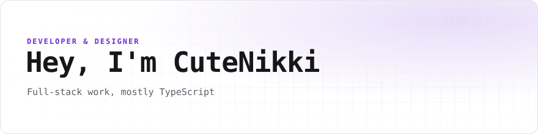
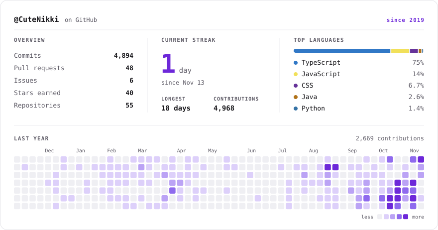
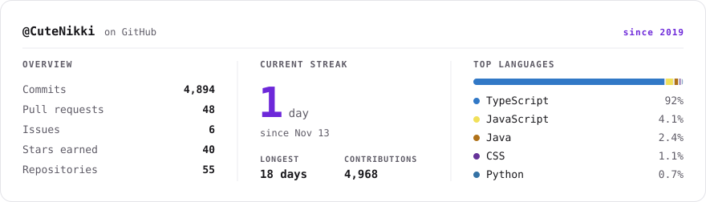
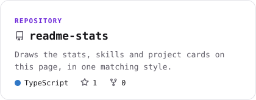
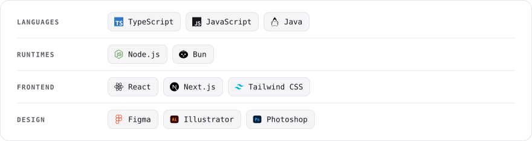
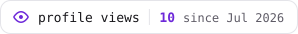

# readme-stats

<picture>
  <source media="(prefers-color-scheme: dark)" srcset="docs/examples/banner-dark.svg">
  
</picture>

Stats, badges, a skills grid and project cards for a GitHub profile README, all in one matching style and in a dark and a light version.

It replaces separate stats, streak and top-language services with one small Bun server. GitHub's answers are kept in memory and fetched again in the background, so after the first request every card comes back in milliseconds.

## Cards

| Path | What it draws |
| --- | --- |
| [`/card?user=you`](#profile-card) | Overview, current streak, top languages and the last year of contributions in one card |
| [`/repo/:owner/:name`](#project-card) | A project card, for showcasing more repos than GitHub's six pins |
| [`/skills?languages=typescript,java`](#skills) | Every skill in one picture, a row per group |
| [`/badge/:icon?label=Discord`](#badges) | A small chip with a [Simple Icons](https://simpleicons.org) logo, for links |
| [`/banner?label=&title=&subtitle=`](#banner) | A header for the top of the README |
| [`/views?user=you`](#view-counter) | A profile view counter |
| [`/stats.json?user=you`](#stats-as-json) | The profile card's numbers as JSON, e.g. for alt text |

Every card takes `?theme=dark` or `?theme=light` (dark is the default). `user=` can be left out and means the first account in `GITHUB_USERS`. `v=` does nothing, so changing it gives a card a new link: GitHub's image proxy keeps a card up to the time it says, so after changing the look, bump `v` to show it straight away.

Open `/` on the server for a preview of every card in both themes. The pictures below are in [`docs/examples`](docs/examples).

### Profile card

`/card?user=you`

<picture>
  <source media="(prefers-color-scheme: dark)" srcset="docs/examples/card-dark.svg">
  
</picture>

- `graph=false` leaves out the contribution graph.
- `langs=5` sets how many languages are shown, up to 8, and `hide=html,css` leaves some out.
- `by=` ranks languages by `bytes` of code, by how many `repos` use them, or by a `mixed` of both (the default, so one big language doesn't fill the whole bar).

`/card?user=you&graph=false&by=bytes`:

<picture>
  <source media="(prefers-color-scheme: dark)" srcset="docs/examples/card-no-graph-dark.svg">
  
</picture>

### Project card

`/repo/:owner/:name`, or `/repo/:name` for a repo of the first account in `GITHUB_USERS`

<picture>
  <source media="(prefers-color-scheme: dark)" srcset="docs/examples/repo-dark.svg">
  
</picture>

- `label=` sets the small line above the name (the first topic otherwise).
- `desc=` replaces the repo's description.

Only public repos of the accounts in `GITHUB_USERS` get a card. Put two side by side with `width="49%"` on each.

### Skills

`/skills?languages=typescript,javascript,java&runtimes=nodedotjs,bun&frontend=react,nextdotjs,tailwindcss&design=figma,ai,ps`

<picture>
  <source media="(prefers-color-scheme: dark)" srcset="docs/examples/skills-dark.svg">
  
</picture>

- Every query key is a group, in the order given, with `_` for spaces (`game_dev=`).
- An entry can carry its own label as `react:React Native`.
- Besides [Simple Icons](https://simpleicons.org) slugs it knows `java`, `node`, `next`, `postgres` and the like, and `ai`/`ps` for Illustrator and Photoshop, which Simple Icons no longer has.
- `title=` adds a heading.

### Badges

`/badge/discord?label=Discord` and `/badge/link?label=Website&value=example.com`

<picture>
  <source media="(prefers-color-scheme: dark)" srcset="docs/examples/badge-discord-dark.svg">
  
</picture>
<picture>
  <source media="(prefers-color-scheme: dark)" srcset="docs/examples/badge-website-dark.svg">
  
</picture>

- `label=` sets the text (the icon's name otherwise), and `value=` adds a second part.
- `color=` recolours the icon, as hex without the `#`. A brand colour that wouldn't show on the card, such as black on dark, falls back to the text colour.
- [Octicons](https://primer.style/octicons) such as `link` work as icons too, for what has no brand. `/badge` without an icon draws just the text.

### Banner

`/banner?label=developer%20%26%20designer&title=Hey%2C%20I'm%20you&subtitle=Full-stack%20work`

The picture at the top of this README. `title=` defaults to "Hey, I'm" and the first account in `GITHUB_USERS`; `label=` and `subtitle=` are left out when not given.

### View counter

`/views?user=you&since=2026-07`

<picture>
  <source media="(prefers-color-scheme: dark)" srcset="docs/examples/views-dark.svg">
  
</picture>

Every request counts as a view, so it's never cached. `since=2026-07` (or a full date) adds when it started counting, and `label=` replaces "profile views". To carry over a count from another counter, set `VIEWS_START`.

### Stats as JSON

`/stats.json?user=you` gives the profile card's numbers as text. It takes the same `langs=`, `hide=` and `by=` as `/card`:

```json
{
  "login": "you",
  "name": "Your Name",
  "createdAt": "2019-04-18T01:20:13Z",
  "followers": 10,
  "commits": 4894,
  "pullRequests": 48,
  "issues": 6,
  "stars": 40,
  "repos": 55,
  "contributedTo": 1,
  "streak": {
    "current": { "days": 1, "start": "2026-11-13", "end": "2026-11-13" },
    "longest": { "days": 18, "start": "2024-10-27", "end": "2024-11-13" }
  },
  "contributions": 4968,
  "lastYear": 2669,
  "languages": [
    { "name": "TypeScript", "color": "#3178c6", "share": 74.85, "label": "75%", "bytes": 13410471, "repos": 44 },
    { "name": "JavaScript", "color": "#f1e05a", "share": 14.48, "label": "14%", "bytes": 596884, "repos": 37 }
  ],
  "views": 1234
}
```

`repos` counts the account's own repos without forks, and `contributedTo` other people's repos it committed, opened pull requests or issues in. A streak's `start` and `end` are dates, or `null` when it's 0 days. Today not having a contribution yet doesn't end the current streak, the same as on the card. `contributions` counts every year, `lastYear` the last twelve months, and `views` is the view counter's count, read without counting a view.

Each language's `share` is its percentage of the languages shown, ranked by `by=` like the card's bar, so the shares add up to 100. `label` is the same number as the card writes it (75% but 6.7%), and `bytes` and `repos` are the raw numbers, over the account's own repos without forks, for working out a share another way. An account that isn't in `GITHUB_USERS` gets a 403 with `{ "error": "..." }`.

Its main use is [alt text that says what the card shows](#alt-text-with-the-latest-numbers).

## Using it in a README

Show the version that matches the reader's theme with `<picture>`:

```html
<picture>
  <source media="(prefers-color-scheme: dark)" srcset="https://stats.example.com/card?user=you&theme=dark">
  
</picture>
```

Write commas in the links as `%2C` (`languages=typescript%2Cjava`), at least in `srcset`: GitHub splits `srcset` at commas, so the dark version would get a link that's cut off there.

### Alt text with the latest numbers

A screen reader can only read the card's `alt`, and an `alt` can't change by itself. A scheduled Action in the profile repo can write the latest numbers into it every day. A script, `.github/scripts/alt-text.mjs`:

```js
import { readFileSync, writeFileSync } from 'node:fs';

const BASE = 'https://stats.example.com';
const USER = 'you';

const response = await fetch(`${BASE}/stats.json?user=${USER}`);
if (!response.ok) throw new Error(`stats.json answered ${response.status}`);
const s = await response.json();

const n = (value) => value.toLocaleString('en-US');
const alt =
  `${s.name}'s GitHub stats: ${n(s.commits)} commits, ${n(s.pullRequests)} pull requests, ${n(s.stars)} stars. ` +
  `Current streak: ${n(s.streak.current.days)} days, longest: ${n(s.streak.longest.days)} days. ` +
  `Top languages: ${s.languages.map((l) => `${l.name} ${l.label}`).join(', ')}.`;

// Replaces the alt of the  whose link starts with BASE/card?
const before = readFileSync('README.md', 'utf8');
const pattern = new RegExp(`(<img src="${BASE.replace(/\./g, '\\.')}/card\\?[^"]*" alt=")[^"]*(")`);
if (!pattern.test(before)) throw new Error('No stats card in README.md');
writeFileSync('README.md', before.replace(pattern, `$1${alt.replace(/&/g, '&amp;').replace(/"/g, '&quot;')}$2`));
```

And `.github/workflows/alt-text.yml`, which runs it every day and commits the README if it changed:

```yaml
name: Alt text

on:
  schedule:
    - cron: '17 4 * * *'
  workflow_dispatch:

permissions:
  contents: write

jobs:
  update:
    runs-on: ubuntu-latest
    steps:
      - uses: actions/checkout@v7
      - uses: actions/setup-node@v7
        with:
          node-version: 24
      - run: node .github/scripts/alt-text.mjs
      - name: Commit, if anything changed
        run: |
          git diff --quiet README.md && exit 0
          git config user.name 'github-actions[bot]'
          git config user.email '41898282+github-actions[bot]@users.noreply.github.com'
          git commit -am 'Update the alt text with the latest numbers'
          git push
```

Commits made with the workflow's own token don't start workflows, so it doesn't set itself off.

## Running it

Copy `.env.example` to `.env` and fill in a GitHub token and the accounts it may draw cards for. Then:

```sh
docker compose up -d --build
```

or, without Docker, `bun install` and `bun run dev`.

Put it behind a reverse proxy with HTTPS: GitHub only loads images over HTTPS. `/health` answers `ok` for uptime checks.

### Configuration

| Variable | What it does |
| --- | --- |
| `GITHUB_TOKEN` | A classic token with `read:user`, plus `repo` so private contributions count. Only ever sent to GitHub. |
| `GITHUB_USERS` | The accounts cards are drawn for, comma-separated, the first being the default. Anyone else gets a 403, so nobody else spends the token's limits. |
| `CACHE_MINUTES` | How long GitHub's answers are kept before they're fetched again, in the background. Default `30`. |
| `DATA_DIR` | Where the view counter keeps its count. Default `./data` (`/data` in Docker, mounted from `./data`). |
| `VIEWS_START` | The number the view counter starts from. Default `0`. |
| `PORT` | Default `3000`. |

### Caching

Cards from GitHub's numbers (`/card`, `/repo`, `/stats.json`) say they're good for 10 minutes, cards that only change with their link (`/skills`, `/badge`, `/banner`) for an hour, and `/views` isn't cached. Every card has an ETag, so a cache that asks again gets a 304 if nothing changed. Errors are pictures too, so a README never shows a broken image.

## Updating the examples

The pictures in `docs/examples` are drawn by a running server. After changing how a card looks:

```sh
bun run dev                     # in one terminal
bun run examples                # in another; BASE=http://localhost:3077 for another port
```

`USER_LOGIN=` sets whose cards are drawn.

## Fonts

The cards carry [JetBrains Mono](https://github.com/JetBrains/JetBrainsMono), cut down to Latin, because an image in a README can't load fonts from anywhere else. It's under the SIL Open Font License, in `fonts/OFL.txt`.
